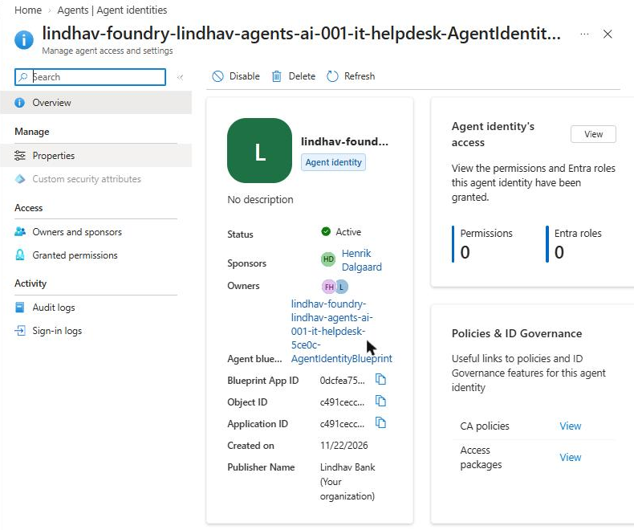
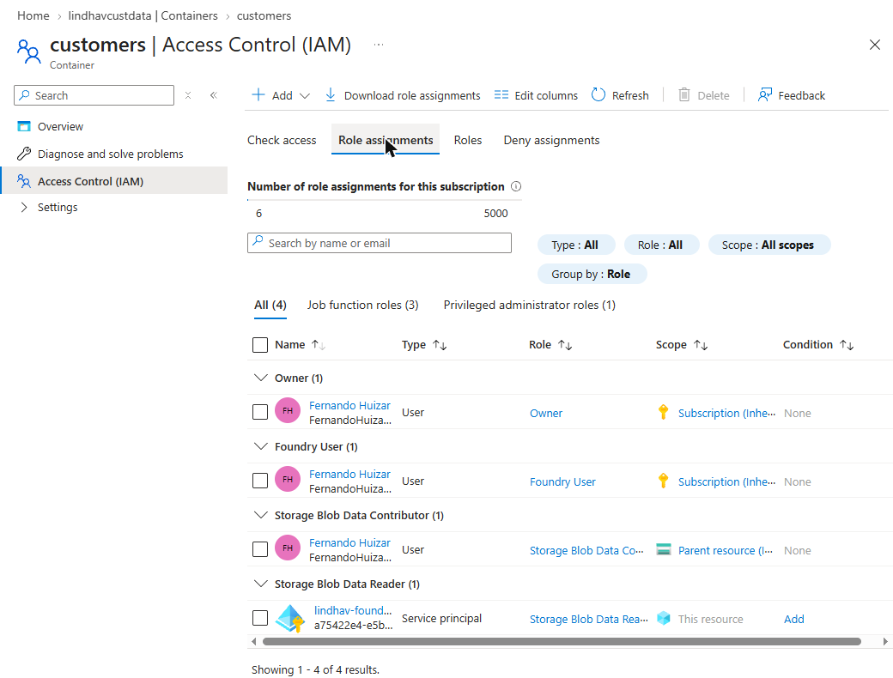
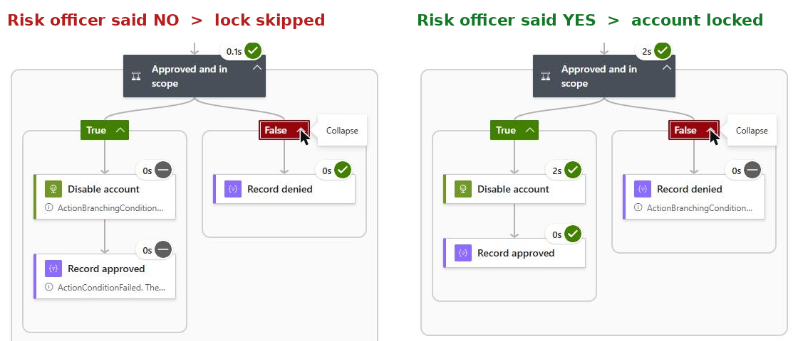
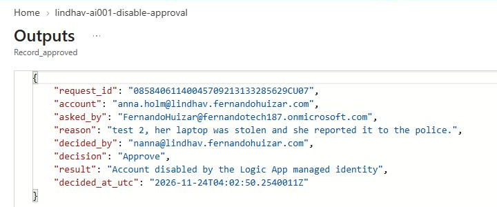
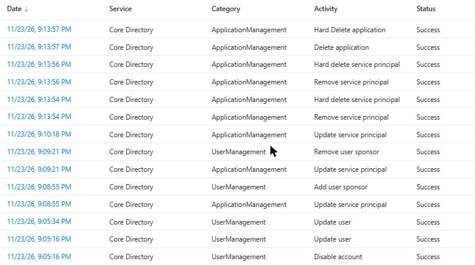

# AI Agent Governance Lab

AI agents are like new employees. They need an ID, a boss, only the keys they need, and a way to be fired. In this personal lab I set that up for 2 AI agents at a made-up Danish bank, using Microsoft Entra and Microsoft Foundry.

## What I did

1. **Gave each agent its own ID and a human owner.** No shared logins. Every agent has a named person who answers for it.
2. **Gave each agent only what it needs.** The helpdesk agent can only read accounts. The customer agent can read customer files, but not HR files.
3. **Made a list of every agent.** A PowerShell script pulls all agents from Entra and flags problems. Its first run found an agent nobody owned.
4. **Turned off shared API keys.** Every call now has to come from a known identity.
5. **Made risky actions wait for a human.** The agent can ask to lock an account. A risk officer has to say yes first.
6. **Tested the off switch and the goodbye.** I shut an agent off in about 30 seconds, made its owner leave, then deleted it and checked nothing was left.

## Proof

**Each agent has its own ID and a human owner (Henrik).**

**The customer agent can only read one folder, the customer files.**

**The agent asked to lock an account. When the risk officer said no, nothing happened. When she said yes, it ran.**

**Every request keeps a record of who asked, who decided and when.**

**The owner left, I moved the agent to her manager, then deleted the agent.**

## Results

| Test | Result |
|---|---|
| Customer agent tries to read HR files | Blocked |
| First run of the agent list | Found 1 agent with no owner, fixed it |
| Old API key after keys were turned off | Stopped working after about 4 minutes |
| Lock request denied | Nothing changed |
| Lock request approved | Account locked, by a separate identity |
| Off switch | Agent stopped in about 30 seconds |
| Owner leaves | Flagged by the agent list 2 minutes later |
| Agent deleted | Nothing left behind |

More detail is in [docs/problem-log.md](docs/problem-log.md), and the other screenshots are in [screenshots](screenshots).

**Built with** Microsoft Entra Agent ID, Microsoft Foundry, Azure Logic Apps, Azure Functions, PowerShell and Microsoft Graph. Everything is fake. The bank, the people and the customers are made up.
